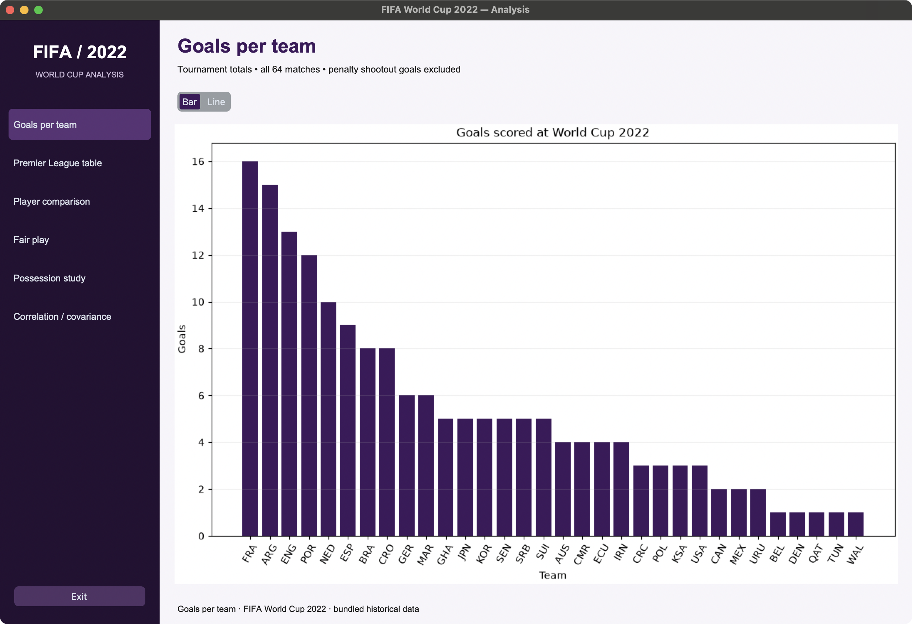
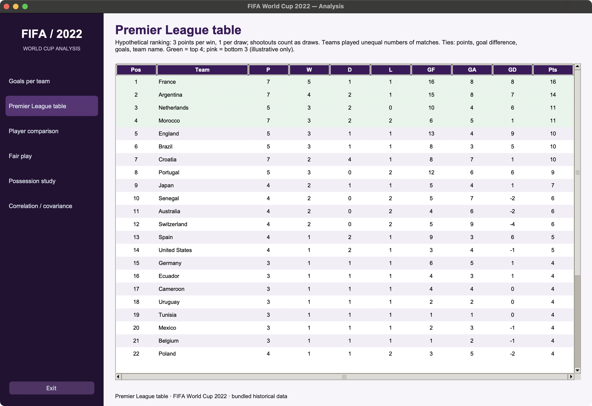
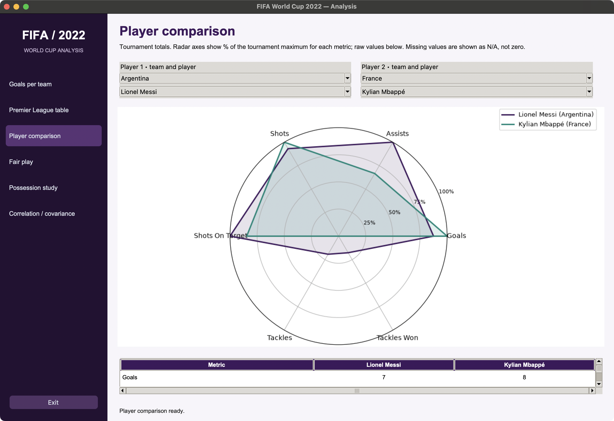
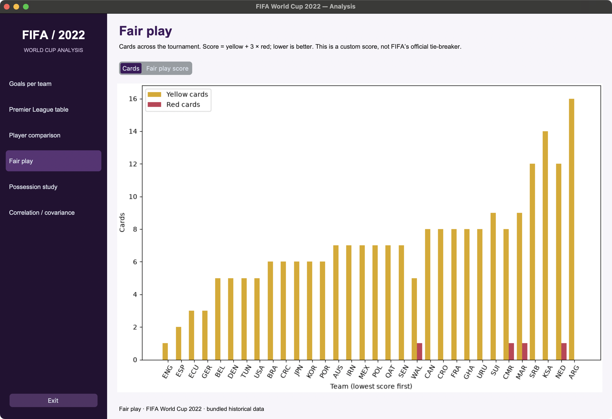
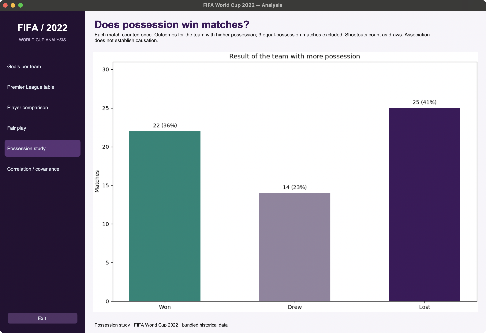
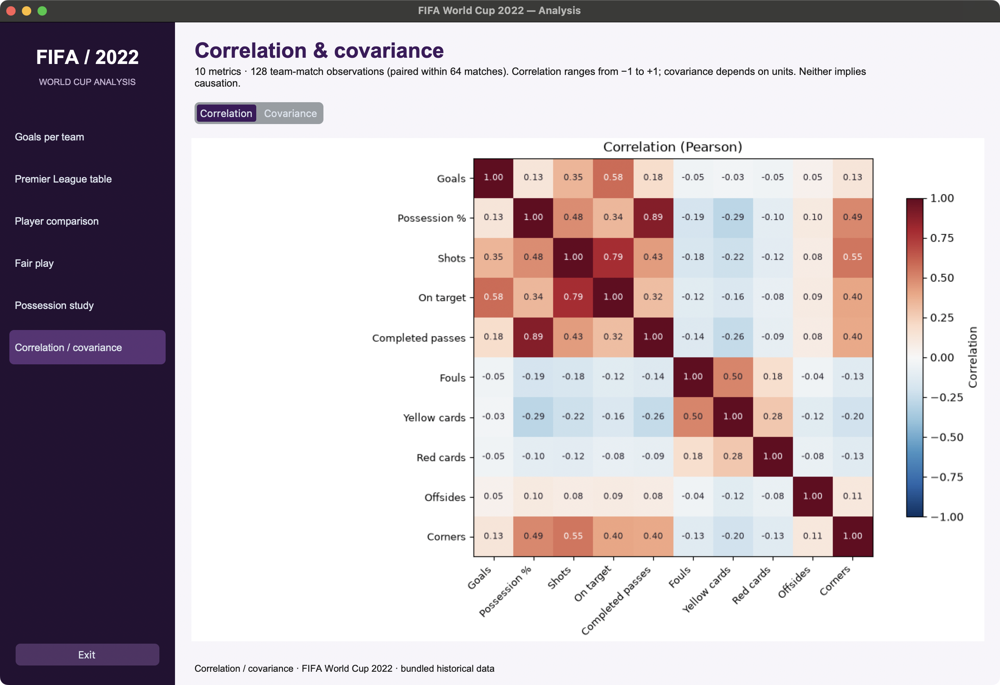

# FIFA World Cup 2022 — Analysis

A single-window desktop dashboard for the bundled World Cup 2022 data. Navigate using the purple sidebar; all charts stay inside the application.

## Run

Use Python 3.10 or newer with Tk support.

```sh
python3 -m venv .venv
source .venv/bin/activate
python -m pip install -r requirements.txt
python main.py
```

On Windows, activate with `.venv\Scripts\activate` instead. On Linux, install your distribution's `python3-tk` package if Tk is missing. Python from python.org includes Tk on macOS and Windows. You can launch `main.py` from another working directory: data paths resolve relative to the project.

## Features

- **Goals per team:** ranked tournament totals, with bar/line toggle.
- **Premier League table:** scrollable 32-team table with P/W/D/L/GF/GA/GD/Pts; top four and bottom three highlighted, with alternating row colors elsewhere.
- **Player comparison:** two team selectors and two dependent player selectors; overlaid radar chart and raw statistics for goals, assists, shots, shots on target, tackles, and tackles won.
- **Fair play:** grouped yellow/red card bars or a weighted score (`yellow + 3 × red`, lower is better).
- **Possession study:** match outcomes for the higher-possession side, counting each match once.
- **Correlation / covariance:** annotated 10×10 heatmaps from 128 team-match observations.
- **Exit:** closes the application. Errors appear in the bottom status area.

## Key findings

These descriptive findings come from the bundled 2022 tournament data:

- **Did the team with more possession usually win?** In 61 matches with unequal possession, that team won 22 (36.1%), drew 14, and lost 25. Three equal-possession matches are excluded; shootouts count as draws. This does not establish whether possession causes wins or losses.
- **Which was more closely associated with goals: possession or shooting?** Across 128 team-match observations, goals had a stronger Pearson correlation with shots on target (**r = 0.58**) than with total shots (**0.35**) or possession (**0.13**). Goals themselves are included in shots on target, so part of this relationship is built into the metric; it is not evidence of predictive performance. Observations are also paired within matches.
- **Who leads the hypothetical league table?** France ranks first with **16 points and 16 goals**, followed by Argentina with **14 points and 15 goals**. This reflects the chosen three-points-per-win rules, with shootouts treated as draws, rather than the official tournament outcome. Teams played unequal numbers of matches, which limits comparisons across the table.

## Screenshots

### Goals per team

Tournament goal totals, with a bar/line toggle.



### Premier League table

A scrollable hypothetical league ranking with points, goal difference, and highlighted positions.



### Player comparison

Lionel Messi and Kylian Mbappé compared across six metrics, with a scrollable raw-statistics table below the radar.



### Fair play

Yellow and red cards by team, with an optional weighted-score view.



### Possession study

Match outcomes for the team with higher possession, excluding equal-possession matches.



### Correlation / covariance

An annotated Pearson correlation heatmap, with a toggle for sample covariance.



<details>
<summary>Regenerate screenshots on macOS</summary>

```sh
python -m pip install pyobjc-framework-Quartz
python scripts/check_gui.py --screenshots
```

Screen-recording permission must be enabled for the app running the command. Fully quit and reopen that app after changing permission. Captures are saved under `assets/screenshots/`.

</details>

## How the analysis works

The league table is a **hypothetical presentation**, not the official World Cup ranking. All group and knockout matches contribute. Scores include extra time but exclude penalty shootouts, so a shootout match counts as a draw. Wins earn three points and draws one. Sorting uses points, goal difference, goals scored, then alphabetical team name. Teams played different numbers of matches; green/pink positions do not represent actual qualification or relegation.

The possession study excludes equal-possession matches from win/draw/loss counts and reports them separately. In the supplied data, the higher-possession side won 22 matches, drew 14 and lost 25; three matches had equal possession. This is descriptive evidence, not proof that possession causes an outcome.

The heatmap uses goals, possession, shots, shots on target, completed passes, fouls, yellow cards, red cards, offsides, and corners. Correlation is Pearson's coefficient; covariance uses the sample denominator `n−1` and a symmetric color scale in the original units. The 128 observations are paired within 64 matches and are not independent. Undefined relationships appear as N/A.

Player radar values are percentages of the maximum observed tournament total **for each metric across all players**, not percentages of the two selected players. These are totals, not per-90 or position-adjusted ability ratings. Raw values remain visible. Missing values are N/A and gaps in the radar, not zeros. Team and player together identify a record. Team aliases are normalized (`IR Iran` → `Iran`, `South Korea` → `Korea Republic`).

The discipline score is a simple custom metric, **not FIFA's official fair-play tie-breaker**. Counts come from the bundled match CSV and are not independently verified.

## Data and provenance

The five CSVs were already bundled in the original repository and have only been renamed:

| Current file | Original file | Role |
| --- | --- | --- |
| `matches.csv` | `Fifa_world_cup_matches(2).csv` | 64 matches; authoritative input for all team analyses |
| `results.csv` | `Fifa Worldcup 2022(2).csv` | 128 team-match rows; retained reference source |
| `player_stats.csv` | `player_stats(1).csv` | 680 players; goals and assists |
| `player_shooting.csv` | `player_shooting(1).csv` | Shots and shots on target |
| `player_defense.csv` | `player_defense(2).csv` | Tackles and tackles won |

Credit: the original FIFA World Cup Analysis repository's bundled datasets. The repository did not record upstream download URLs, authors, or data licenses, so specific provider attribution cannot be verified. Confirm provenance and redistribution terms before republishing the data. The two match sources differ in some possession values; analyses consistently use `matches.csv` rather than mixing sources. No remote data is fetched at runtime.

## Project layout

```text
main.py                 Entry point
fifa/app.py             App state, navigation, styles, status handling
fifa/data.py            One-time CSV loading and pure analysis methods
fifa/views/             Six show(parent) views and shared GUI helpers
assets/screenshots/     Six application screenshots
scripts/check_gui.py    Desktop smoke checks and optional macOS captures
tests/test_data.py      Calculation regression tests
```

Each view exports `show(parent)`. The App supplies `parent.data` and `parent.set_status`. Views share embedded Matplotlib helpers and dispose of old widgets on navigation. The old terminal menu, PrettyTable output, input loops, and standalone plot windows have been removed.

## Verification

```sh
python -m unittest discover -s tests -v
python scripts/check_gui.py
```

The first command checks tournament totals, standings tie-breaks, shootout semantics, possession pairing and counts, matrices, player lookup/missing data, the fair-play formula, and absence of repeated CSV reads. The second requires a graphical desktop and exercises all navigation buttons, toggles, and player selectors. On macOS, `python scripts/check_gui.py --screenshots` also refreshes the six captures (install the optional `pyobjc-framework-Quartz` helper; screen recording permission may be needed).

## Optional desktop build

Build on the target operating system after installing PyInstaller:

```sh
python -m pip install pyinstaller
pyinstaller --onefile --windowed --name FIFA2022 --collect-all customtkinter --add-data "matches.csv:." --add-data "results.csv:." --add-data "player_stats.csv:." --add-data "player_shooting.csv:." --add-data "player_defense.csv:." main.py
```

The resulting program appears in `dist/`. This optional distribution build has not been tested; source execution is the supported path.
